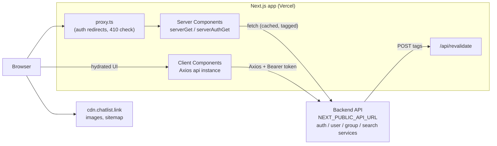
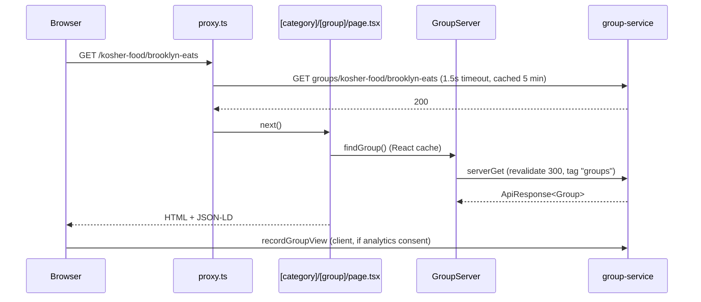
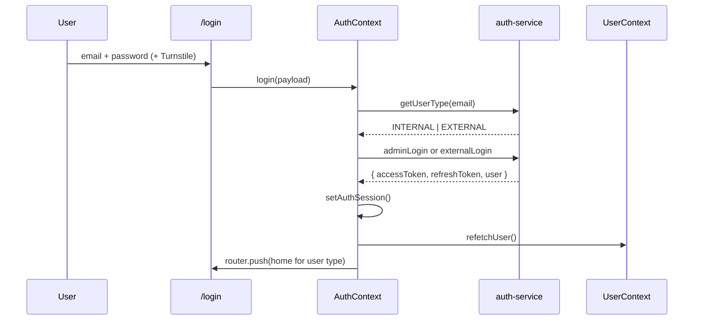

# ChatList Frontend: Technical Documentation

> Scope: the Next.js web client in this repository (`jewishchat`). Backend services (auth, user, group, search) are referenced only where the frontend depends on them.

## Contents

1. [Introduction and Purpose](#1-introduction-and-purpose)
2. [Technology Stack](#2-technology-stack)
3. [Application Architecture](#3-application-architecture)
4. [Project Structure](#4-project-structure)
5. [Installation and Setup](#5-installation-and-setup)
6. [Routing and Navigation](#6-routing-and-navigation)
7. [Component Documentation](#7-component-documentation)
8. [State Management](#8-state-management)
9. [API Integration](#9-api-integration)
10. [Authentication and Authorization](#10-authentication-and-authorization)
11. [Error Handling and Validation](#11-error-handling-and-validation)
12. [Cross-cutting Concerns](#12-cross-cutting-concerns)
13. [Testing](#13-testing)
14. [Code Quality and Conventions](#14-code-quality-and-conventions)
15. [Build and Deployment](#15-build-and-deployment)
16. [Appendix](#16-appendix)

---

## 1. Introduction and Purpose

**ChatList** (`https://chatlist.link`) is a directory for discovering and joining WhatsApp groups for Jewish businesses, organizations and communities. The frontend serves three audiences from one Next.js application:

| Area | Audience | What they do |
|---|---|---|
| **Public site** | Anonymous visitors | Browse categories, search groups, view group pages, join groups |
| **Member area** | Signed-in external users | Submit and edit groups, manage profile, verify WhatsApp, view owner analytics dashboard |
| **Internal admin** | Internal (staff) users | Moderate groups and reports, manage users, roles and categories, view platform and search insights |

### Glossary

| Term | Meaning |
|---|---|
| **Group** | A WhatsApp group listing. Has a `slug`, a `mainCategory`, a status and a location. Public URL: `/{categorySlug}/{groupSlug}` |
| **Category** | Top-level grouping of groups (e.g. a topic). Public URL: `/{categorySlug}` |
| **Draft** | A group submission in progress. Created on step 1 of `/groups/new`, submitted on the final step |
| **External user** | A public member (`UserType.EXTERNAL`) |
| **Internal user** | A staff/admin user (`UserType.INTERNAL`), invited via email |
| **Report** | A user-submitted complaint about a group. Groups exceeding configurable thresholds are flagged |
| **Suspension** | Moderation action that takes a group (or user) offline with a reason |
| **Gone** | A permanently removed group. The proxy returns HTTP `410` for its URL |
| **Join token** | Short-lived token exchanged for the real WhatsApp invite URL, so invite links are never exposed in page HTML |

---

## 2. Technology Stack

| Area | Library | Notes |
|---|---|---|
| Framework | **Next.js 16** (App Router), **React 19** | React Compiler enabled (`reactCompiler: true`) |
| Language | **TypeScript 5** (strict) | |
| Styling | **Tailwind CSS v4**, `tw-animate-css` | Design tokens in `src/styles/globals.css` via `@theme` |
| UI primitives | **shadcn** (`radix-nova` style), **Radix UI**, **Base UI** | `class-variance-authority`, `clsx`, `tailwind-merge` |
| Icons | `lucide-react`, `country-flag-icons` | |
| Forms | **react-hook-form** | `libphonenumber-js` for phone validation |
| Bot protection | `@marsidev/react-turnstile` (Cloudflare Turnstile) | |
| HTTP | **Axios** (browser), native `fetch` (server) | |
| Loading state | `react-promise-tracker` | Drives the global overlay loader |
| Notifications | **Sonner** | |
| Charts | **Recharts** | Admin and owner dashboards |
| Motion | **GSAP**, **Lenis**, `lottie-react`, **Three.js** | Smooth scroll, reveals, hero visuals |
| Dates | `dayjs` | |
| Location data | `country-region-data` | |
| Theming | `next-themes` | |
| Testing | **Vitest**, **Testing Library**, `jsdom` | |
| Lint / format | ESLint 9 (flat config), Prettier | |

**Runtime requirements:** Node.js `>= 24` (see `.nvmrc`). Dev and prod servers run on port **4000**.

---

## 3. Application Architecture

### 3.1 High-level view



### 3.2 Rendering strategy

| Kind of page | Rendering | Data source | Examples |
|---|---|---|---|
| Public, SEO-critical | Server Components with **ISR** (`export const revalidate`) | `GroupServer`, `UserServer`, `seo.service` via `serverGet` | `/` (600s), `/[category]` (300s), `/[category]/[group]` (300s), `/profile/[user]` (300s) |
| Public, query-driven | Server Component, **no-store** | `SearchServer` | `/groups?q=…` |
| Admin pages with initial data | Server Component fetches with the user's cookie, then hands off to a client component | `DashboardServer`, `GroupAdminServer`, `UserServer.getAdmin*` via `serverAuthGet` | `/internal`, `/internal/groups/[group]`, `/internal/users/[user]` |
| Interactive / authenticated | Client Components (`"use client"`) | Axios services | `/profile`, `/groups/mine`, `/groups/new`, `/dashboard`, admin tables |

The rule of thumb: **anything indexable is rendered on the server and cached by tag; anything behind a login is client-rendered** (optionally seeded with server data).

### 3.3 Request lifecycle

1. The request hits **`src/proxy.ts`** (Next 16's replacement for `middleware.ts`). It redirects `/home` to `/`, returns `410 Gone` for removed groups, and enforces auth-based redirects ([§10](#10-authentication-and-authorization)).
2. The **root layout** (`src/app/layout.tsx`) mounts fonts, site-wide JSON-LD and the global providers.
3. The **route-group layout** wraps the page in the right shell: `ExternalShell` (public), `AppShell` (admin) or nothing (auth pages).
4. The **page** fetches data on the server and/or renders client components that call services.
5. **Services** call the backend. Server calls are cached by tag. Client calls go through the shared Axios instance with interceptors.

### 3.4 Provider tree

```
<html>
  <body>
    <JsonLd />                       site-wide Organization + WebSite schema
    <TooltipProvider>
      <UserProvider>                 current user profile
        <AuthProvider>               login / signup / logout actions
          {route group layout}
          <EmailVerificationGate />  forces OTP modal for unverified emails
        </AuthProvider>
      </UserProvider>
      <GlobalLoader />               overlay for requests with globalLoader: true
    </TooltipProvider>
    <Toaster />                      Sonner
    <NetworkStatusWatcher />         offline / slow-connection toasts
  </body>
</html>
```

---

## 4. Project Structure

```
.
├── .github/workflows/        SEO check workflows (PR preview + daily production)
├── public/                   favicon, SVGs (logo, auth illustrations)
├── scripts/seo-check/        SEO regression checker used by CI
├── src/
│   ├── app/                  App Router: routes, layouts, route-local components
│   │   ├── (auth)/           login, signup, password reset, invite acceptance
│   │   ├── (external)/       public site + signed-in member area
│   │   ├── internal/         admin console
│   │   ├── api/revalidate/   on-demand cache revalidation webhook
│   │   ├── layout.tsx        root layout
│   │   ├── not-found.tsx
│   │   └── robots.ts
│   ├── assets/animations/    Lottie JSON files
│   ├── components/
│   │   ├── layout/           app (admin) shell, auth, external shell
│   │   ├── providers/        SmoothScroll
│   │   ├── seo/              JsonLd
│   │   └── ui/               shared UI component library
│   ├── configs/              constants, navigation, FAQ, locations, search suggestions
│   ├── contexts/             global React contexts
│   ├── hooks/                shared custom hooks
│   ├── lib/                  framework-agnostic helpers (auth storage, paths, dates, …)
│   ├── services/             API layer, one folder per backend domain
│   ├── styles/globals.css    Tailwind entry + design tokens
│   ├── test/setup.ts         Vitest setup
│   ├── types/                shared domain types
│   └── proxy.ts              request proxy (auth + 410 handling)
├── components.json           shadcn config
├── eslint.config.mjs
├── next.config.ts
└── vitest.config.mts
```

### Conventions

| Convention | Rule |
|---|---|
| Route-local code | Components used by one route live in that route's `_components/`; route-scoped state lives in `_context/`. The underscore keeps them out of routing |
| Shared code | Promote to `src/components/ui`, `src/hooks` or `src/lib` once used by more than one route |
| File names | Components in `PascalCase.tsx`; hooks `useThing.ts`; helpers `camelCase.ts` |
| Services | `<domain>.service.ts` (client, Axios), `<domain>.server.ts` (server, `fetch`), `<domain>.types.ts` |
| Tests | Next to the file under test: `thing.ts` + `thing.test.ts` |
| Path aliases | `@/*` → `src/*`, `@components/*`, `@configs/*`, `@public/*` |

---

## 5. Installation and Setup

### 5.1 Prerequisites

- Node.js 24 (`nvm use` reads `.nvmrc`)
- npm (the repo ships a `package-lock.json`)
- Access to a running backend API

### 5.2 Install and run

```bash
npm install
npm run dev        # http://localhost:4000
```

| Script | Purpose |
|---|---|
| `npm run dev` | Dev server on port 4000 |
| `npm run build` | Production build |
| `npm run start` | Serve the production build on port 4000 |
| `npm run lint` | ESLint |
| `npm test` | Run Vitest once |
| `npm run test:watch` | Vitest in watch mode |

### 5.3 Environment variables

Create `.env` (or `.env.local`) in the repo root.

| Variable | Required | Exposed to browser | Purpose |
|---|---|---|---|
| `NEXT_PUBLIC_API_URL` | Yes | Yes | Base URL of the backend gateway (e.g. `https://api.example.com`). Used by Axios, server fetches, the proxy and beacons. Falls back to `/api` in the browser if unset |
| `NEXT_PUBLIC_TURNSTILE_SITE_KEY` | Yes, for forms with captcha | Yes | Cloudflare Turnstile site key |
| `REVALIDATE_SECRET` | Yes, in deployed envs | No | Shared secret the backend sends in `x-revalidate-secret` to `/api/revalidate`. Without it, the endpoint returns `503` |

### 5.4 Troubleshooting

| Symptom | Likely cause |
|---|---|
| All data empty, no errors | `NEXT_PUBLIC_API_URL` missing. Server fetches fall back to empty arrays |
| Captcha never completes | `NEXT_PUBLIC_TURNSTILE_SITE_KEY` missing or wrong domain |
| Remote images fail to load | Image host is not `cdn.chatlist.link` (the only allowed `remotePatterns` host in `next.config.ts`) |
| Redirect loop to `/login` | Stale `accessToken`/`userType` cookies. Clear site data |

---

## 6. Routing and Navigation

### 6.1 Route groups

#### `(auth)`: no shell, `noindex`

| Path | Purpose |
|---|---|
| `/login` | Email/password login. Resolves the user type first, then calls the internal or external login endpoint |
| `/signup` | External user registration with email OTP verification |
| `/forgot-password` | Request reset email |
| `/reset-password` | Set new password from emailed token |
| `/accept-invite` | Internal user activates an invited account (always accessible, even when logged in) |

#### `(external)`: `ExternalShell` + smooth scroll

| Path | Auth | Rendering | Purpose |
|---|---|---|---|
| `/` | Public | ISR 600s | Home: hero search, featured groups, categories, stats, FAQ |
| `/home` | Public | n/a | 308 redirect to `/` |
| `/categories` | Public | Server | All categories |
| `/[category]` | Public | ISR 300s | Category landing page with group listing and search |
| `/[category]/[group]` | Public | ISR 300s | Group page: details, join action, related groups, report |
| `/groups` | Public | Server, no-store | Search directory. URL params: `q` (free-text search), `name` (group name contains), `category`, `city`, `country`, `sort` |
| `/groups/new` | Public (login needed to submit) | Client | Multi-step group submission |
| `/groups/mine` | **Signed in (enforced by proxy)** | Client | The user's submitted groups |
| `/groups/mine/[category]/[group]` | **Signed in (enforced by proxy)** | Client | Edit one of the user's groups |
| `/profile` | **Signed in (enforced by proxy)** | Client | Own profile, photo, WhatsApp verification |
| `/profile/[user]` | Public | ISR 300s | Public member profile |
| `/dashboard` | **Signed in (enforced by proxy)** | Client | Group owner analytics |
| `/about`, `/contact`, `/policies` | Public | Static | Content pages |

#### `internal/`: `AppShell` (sidebar + navbar), internal users only, `noindex`

| Path | Purpose |
|---|---|
| `/internal` | Platform dashboard (growth, traffic, moderation, reports) |
| `/internal/search-insights` | Search query analytics, zero-result queries, CSV export |
| `/internal/users`, `/internal/users/[user]` | External and internal user management |
| `/internal/roles`, `/internal/roles/[role]` | Roles and permission assignment |
| `/internal/groups`, `/internal/groups/[group]` | Group moderation (approve, reject, suspend, reactivate, delete) |
| `/internal/reports`, `/internal/reports/[report]` | Report queue and resolution, threshold configuration |
| `/internal/categories` | Category CRUD with icon picker |

#### Other

| Path | Purpose |
|---|---|
| `POST /api/revalidate` | Backend-triggered cache invalidation ([§9.5](#95-caching-and-revalidation)) |
| `POST/DELETE /api/auth/session`, `POST /api/auth/refresh` | HttpOnly session cookie management ([§10.1](#101-session-model)) |
| `/robots.txt` | Generated by `robots.ts`. Sitemap is served from the CDN |

### 6.2 Dynamic segments and reserved slugs

`/[category]` and `/[category]/[group]` catch any top-level path, so real routes must never collide with category slugs. `RESERVED_ROUTE_SLUGS` in `src/configs/const.ts` lists the words that can't be categories (`groups`, `login`, `dashboard`, `internal`, `api`, …). Pages call `notFound()` when a reserved slug reaches them.

> **When adding a new top-level route**, add its segment to `RESERVED_ROUTE_SLUGS`. Also add it to `STATIC_TOP_LEVEL_SEGMENTS` in `proxy.ts` if it can have two path segments.

Route params are decoded with `decodeRouteParam`. All public URLs are built with helpers in `src/lib/publicPaths.ts`: `getCategoryPath`, `getGroupPath`, `getGroupEditPath`, `getMemberProfilePath`.

### 6.3 Canonical URLs and redirects

The group page enforces one canonical URL:

1. Group not found → ask `resolveSeoRedirect()` for a historical path → `permanentRedirect` if one exists, otherwise `notFound()`.
2. Group found under a non-canonical category → `permanentRedirect` to `getGroupPath(group)`.
3. Group permanently removed → the proxy has already returned `410` with a static HTML page.

### 6.4 Navigation config

| File | Used by |
|---|---|
| `configs/externalNav.ts` | Public navbar links (Find Groups, Categories, Add Group) |
| `configs/footerNav.ts` | Public footer |
| `configs/sidebarNav.ts` | Admin sidebar sections, keyed by `UserType`. `INTERNAL` has the full admin menu. `EXTERNAL` is empty because external users never see `AppShell` |
| `lib/nav.ts` → `getActiveHref` | Picks the longest matching href for active-state highlighting |
| `components/ui/Breadcrumbs.tsx` | Breadcrumb trail. Member profile crumbs come from `getMemberProfileCrumbs` |

### Key files
`src/proxy.ts` · `src/configs/const.ts` · `src/lib/publicPaths.ts` · `src/app/(external)/[category]/[group]/page.tsx`

---

## 7. Component Documentation

### 7.1 Design tokens

Tokens are declared in `src/styles/globals.css` under `@theme inline` and used as Tailwind classes.

| Group | Tokens | Example classes |
|---|---|---|
| Brand | `brand-green`, `brand-deep`, `brand-soft`, `brand-softer` | `text-brand-green`, `bg-brand-soft` |
| Ink (text) | `ink-1` (strongest) … `ink-4` (muted) | `text-ink-3` |
| Surface | `surface-bg`, `surface-card`, `surface-line`, `surface-line-strong`, … | `bg-surface-card border-surface-line` |
| State | `state-success/danger/warn/info`, `state-bg-*` | `text-state-danger` |
| Fonts | `font-sans` (Geist), `font-mono` (Geist Mono), `font-display` (Bricolage Grotesque), `font-accent` (Instrument Serif italic) | `font-display` |

Use tokens rather than raw hex values. Use `Typography` (with variants in `TypographyVariants.ts`) rather than ad-hoc text sizes.

### 7.2 UI library (`src/components/ui`)

| Category | Components |
|---|---|
| **Inputs** | `Input`, `Textarea`, `Select`, `SelectDropdown`, `Combobox`, `Checkbox`, `Switch`, `DatePicker`, `DateRangeFields`, `Calendar`, `PhoneInput`, `OtpInput`, `Field`, `Label`, `SearchDropdown`, `ConversationalSearchBar`, `SearchFilterChip` |
| **Actions** | `Button`, `Link`, `CopyButton`, `Fab` |
| **Overlays** | `Modal`, `Drawer`, `Sheet`, `Popover`, `Tooltip`, `DeleteModal`, `ChangePhotoModal`, `SuspendGroupModal` |
| **Data display** | `DataTable`, `Table`, `Card`, `Chip`, `Avatar`, `AvatarStack`, `UserCard`, `Accordion`, `Collapsible`, `Tabs`, `TabsHeader`, `Breadcrumbs`, `LinkDisplay`, `Attachment`, `Progress`, `Separator`, `Typography`, `Icon` |
| **Flows** | `Stepper`, `StepperCard`, `ImageCropper` |
| **Feedback & states** | `Sonner` (Toaster), `Skeleton`, `NoData`, `ErrorState`, `LoadFailed`, `NotFound`, `ComingSoon`, `Banner`, `SwitchBanner`, `GroupSuspensionBanner`, `ModerationActionsCard` |
| **Visual / motion** | `Aurora` (`GradientBackdrop`), `Grainient`, `LatticeBackdrop`, `LazyLottie` |

### 7.3 Key components

#### `DataTable<T>`
Generic table used by every admin listing. On mobile it can switch to cards with infinite scroll.

| Prop | Type | Purpose |
|---|---|---|
| `columns` | `{ id, header, cell(row, i), headerClassName?, cellClassName?, skeletonCell? }[]` | Column definitions (usually in a route's `columns.tsx`) |
| `data` | `T[]` | Current page rows |
| `getRowId` | `(row, i) => string` | Stable row key |
| `pagination` | `{ page, pageSize, total, onPageChange, onPageSizeChange?, pageSizeOptions? }` | Numbered pagination (desktop) |
| `selectable`, `selectedIds`, `onSelectedIdsChange` | | Row selection with checkboxes |
| `renderCard`, `cardData`, `infiniteScroll` | | Mobile card layout and "load more" |
| `loading`, `skeletonRowCount` | | Skeleton rows while fetching |
| `emptyState`, `rowClassName`, `stickyHeader`, `className` | | Presentation |

```tsx
<DataTable
  columns={columns}
  data={users}
  getRowId={(u) => u.uuid}
  loading={isLoading}
  pagination={{ page, pageSize, total, onPageChange: setPage }}
  renderCard={(u) => <ExternalUserCard user={u} />}
/>
```

#### `Modal`
Composable: `Modal` › `ModalContent` (`variant`) › `ModalHeader` (`icon`) › `ModalTitle` / `ModalDescription`. Controlled through `open` / `onOpenChange`. See `EmailVerificationGate.tsx` for a complete example.

#### `StepperCard`
Drives multi-step flows such as `/groups/new`. It takes `{ id, title, cardTitle, description, children }[]`. Steps can be conditional (e.g. the review step appears only for users without WhatsApp verification).

#### `Button`, `Typography`
Built with `cva`. They export both the component and the variants function (`buttonVariants`, `typographyVariants`) so other elements can reuse the styles.

### 7.4 Layout components (`src/components/layout`)

| Folder | Components | Role |
|---|---|---|
| `app/` | `AppShell`, `Sidebar`, `Navbar`, `AppHeader`, `UserMenu`, `GlobalLoader`, `NetworkStatusWatcher`, `EmailVerificationGate` | Admin shell and global overlays |
| `external/` | `ExternalShell`, `ExternalNavbar`, `ExternalFooter`, `ShellLatticeBand`, `CookieBanner`, `CookieSettingsModal`, `CookieSettingsLink`, `PendingGroupDraftRedirect` | Public site shell |
| `auth/` | `AuthIllustration`, `TransitionLink` | Auth page visuals |

### 7.5 Adding a new UI component

1. If shadcn has it, run `npx shadcn add <name>`. `components.json` points output to `@/components/ui`.
2. Rename the file to `PascalCase.tsx` to match the library.
3. Replace colors with design tokens. Use `cn()` from `@/lib/utils` to merge classes.
4. Use `cva` for variants and export the variants function alongside the component.
5. Add a test if the component has behavior (see `components/ui/inputs.test.tsx`).

---

## 8. State Management

There is no global store library. State lives in **React context** (cross-cutting), **route-scoped context** (feature state) and **local component state**. Server data is passed down from Server Components or fetched in client components through services.

### 8.1 Global contexts (`src/contexts`)

| Context | Hook | Holds | Provided in |
|---|---|---|---|
| `UserContext` | `useUser()` | `user`, `isLoading`, `hasPermission(p)`, `refetchUser()`, `clearUser()`. Profile is cached in `sessionStorage` for 60s per token | Root layout |
| `AuthContext` | `useAuth()` | `login`, `signup`, `verifyEmail`, `acceptInvite`, `resendOtp`, `resolveUserType`, `logout` | Root layout |
| `SearchFilterContext` | `useSearchFilter()` | Draft vs applied filter sets for admin tables (`filters`, `appliedFilters`, `applyFilters`, `clearFilter`, …) | `internal/layout.tsx` |
| `CookieConsentContext` | (see file) | Analytics consent, backed by the `cookieConsent` cookie (180 days) | `ExternalShell` |

### 8.2 Route-scoped contexts (`_context/`)

| Context | Route |
|---|---|
| `HomeContext`, `HeroSearchContext` | `/` (home sections, hero search state) |
| `GroupsContext` | `/groups/*` |
| `CategoryContext` | `/internal/categories` |
| `AdminGroupContext` | `/internal/groups` |
| `ReportContext` | `/internal/reports/[report]` |
| `RoleContext` | `/internal/roles` |
| `UserManagementContext` | `/internal/users` |

### 8.3 Shared hooks (`src/hooks`)

| Hook | Purpose |
|---|---|
| `useDebouncedValue(value, ms)` | Debounce input (search, email availability) |
| `useCharacterCount` | Live character count for inputs/textareas with limits |
| `useExpiry` | Countdown/expiry state (OTP, tokens) |
| `useJoinGroup(slug)` | Join flow: get a join token, redeem it, open WhatsApp in a new tab, handle 401/403/410 |
| `useKeyboardInset` | Mobile on-screen keyboard offset |
| `useNetworkStatus` | `{ online, slow }` from browser APIs plus measured API latency |
| `useTurnstile(options?)` | Renders the Turnstile widget. Returns `{ token, widget, isReady, reset }` |

Route-specific hooks live in `_components/` (e.g. `useOwnerDashboard`, `useSearchPerformance`, `useInsightsPage`, `useExportInsights`).

### 8.4 Browser storage

| Key | Storage | Owner | Contents |
|---|---|---|---|
| `accessToken`, `refreshToken` | **HttpOnly** cookie (7 days, `SameSite=Lax`, `Secure` in production) | `/api/auth/*` routes | Not readable by JavaScript. Read by `proxy.ts`, `serverAuthGet` and the refresh route |
| `userType` | Cookie (7 days) | `/api/auth/*` routes | Readable. The client uses it to tell whether a session exists |
| (access token) | Memory only | `lib/auth.ts` | Lost on reload and restored through `/api/auth/refresh` |
| `profile` | sessionStorage | `UserContext` | Cached profile (60s TTL) |
| `pendingGroupDraft` | sessionStorage | `lib/pendingGroupDraft.ts` | Unsaved group form while the user logs in |
| `groupViews` | sessionStorage | `services/group/groupView.ts` | View de-duplication (5 min) |
| `cookieConsent` | Cookie (180 days) | `lib/cookieConsent.ts` | Analytics opt-in |

### 8.5 Choosing where state goes

- **Local state** by default.
- **Route `_context/`** when sibling components in one feature share it (e.g. a table, its filters and its modals).
- **Global context** only for session-wide concerns (user, auth, consent).
- **Server Component props** for data that can be fetched at render time.

---

## 9. API Integration

### 9.1 Backend services

All calls go to `NEXT_PUBLIC_API_URL` with a service prefix:

| Prefix | Domain |
|---|---|
| `auth-service/api/v1/…` | Login, signup, OTP, tokens, invites, password reset |
| `/user-service/api/v1/…` | Profiles, admin user management, WhatsApp verification, profile photos |
| `/group-service/api/v1/…` (`GROUP_SERVICE`) | Groups, categories, drafts, reports, stats, dashboards, SEO lookups |
| `/search-service/api/v1/…` (`SEARCH_SERVICE`) | Search and autocomplete |

Responses are wrapped in `ApiResponse<T>` (`{ message, data, status }`). Paginated payloads use `Paginated<"key", T>` (`{ totalPages, currentPage, totalElements, [key]: T[] }`).

### 9.2 Client-side: Axios instance (`services/axiosConfig.ts`)

A single typed instance, `api`. Its `get/post/put/patch/delete` return the **response body** (`response.data`), not the Axios response.

```ts
const res = await api.get<ApiResponse<User>>("/user-service/api/v1/users/me");
res.data; // User
```

Per-request flags (declared by module augmentation on `AxiosRequestConfig`):

| Flag | Effect |
|---|---|
| `globalLoader: true` | Tracks the promise in the `"global"` area, so `GlobalLoader` shows a full-screen spinner |
| `silentError: true` | Suppresses the error toast |
| `silentSuccess: true` | Suppresses the success toast on mutations |
| `skipAuthRefresh: true` | Don't attempt a token refresh on 401 |

Interceptors (`services/utils/setupInterceptors.ts`) do the following:

1. **Request:** attach `Authorization: Bearer <accessToken>` from memory, restoring it through the refresh route first after a reload. Log the request in non-production builds.
2. **Response success:** for `POST/PUT/PATCH/DELETE`, toast the server's `message` unless `silentSuccess` is set. Report latency to `networkHealth`.
3. **Response 401:** refresh the token once through `/api/auth/refresh`, sharing one in-flight refresh across concurrent requests, then retry. If the refresh fails, clear the session and redirect to `/login`.
4. **Other errors:** go to `errorHandler`, which toasts the server message or "Something went wrong".

### 9.3 Server-side fetching

| Helper | File | Auth | Caching | On failure |
|---|---|---|---|---|
| `serverGet<T>(path, { params, revalidate, tags })` | `services/serverFetch.ts` | None | `next.revalidate` + `tags`, or `no-store` when `revalidate: 0` | Throws `ServerApiError(status, url)` |
| `serverAuthGet<T>(path, params)` | `services/serverAuthFetch.ts` | `accessToken` cookie | Always `no-store` | Returns `null` |

Server service modules wrap these helpers: `GroupServer`, `GroupAdminServer`, `UserServer`, `SearchServer`, `DashboardServer`, and `seo.service` (`resolveSeoRedirect`, `isCategoryIndexable`).

Per-request de-duplication uses React `cache()`, for example in `getCachedCategories`, `getCachedHomeData`, and `findGroup` on the group page. That way `generateMetadata` and the page share one fetch.

### 9.4 Service module pattern

```
services/<domain>/
  <domain>.service.ts   client: export const XService = { method: (…) => api.get<…>(…) }
  <domain>.server.ts    server: export const XServer = { method: (…) => serverGet<…>(…) }
  <domain>.types.ts     request/response types used only by this domain
```

Shared domain types live in `src/types` (`Group`, `Category`, `User`, `Report`, `Role`, `Search`, `Dashboard`, …).

**Example: the group page, end to end**



### 9.5 Caching and revalidation

| Tag | Default TTL | Covers |
|---|---|---|
| `categories` | 3600s (list), 300s (detail) | Category list and detail |
| `groups` | 300s | Group lists, group detail, related groups |
| `stats` | 600s | Platform stats, active countries |
| `users` | 300s | Public member profiles |
| `seo` | 300s | Redirect and indexability lookups |

When data changes, the backend calls:

```http
POST /api/revalidate
x-revalidate-secret: <REVALIDATE_SECRET>
Content-Type: application/json

{ "tags": ["groups", "stats"] }
```

The route compares secrets in constant time and ignores unknown tags. It calls `revalidateTag(tag, "max")` for each known tag. Responses: `200 { revalidated, at }`, `400` (no valid tags), `401` (bad secret), `503` (secret not configured).

### 9.6 File uploads

Group and profile photos use **presigned URLs**:

1. `getGroupPhotoUploadUrl(uuid)` / `getProfilePictureUploadUrl()` returns an upload URL.
2. The image is converted to PNG and downscaled (`lib/image.ts` → `toPngFile`).
3. A plain `axios.put` sends the file to the upload URL with progress callbacks. It bypasses the `api` instance so no auth header is sent.
4. Profile photos are then confirmed with `confirmProfilePicture`.

Limits: `image/jpeg|png|webp`, max 5 MB (`IMAGE_ACCEPTED_TYPES`, `IMAGE_MAX_FILE_SIZE`).

### 9.7 Fire-and-forget tracking

`lib/beacon.ts` → `postBeacon(path, payload)` uses `navigator.sendBeacon`, falling back to `fetch` with `keepalive`. It's used for search click attribution (`services/search/searchClick.ts`), so the event survives the navigation that follows the click.

### 9.8 Adding a new endpoint

1. Add types to `src/types/<Domain>.ts` (or `<domain>.types.ts` if they're local to the service).
2. Add a method to `XService` (client) and/or `XServer` (server). Use `ApiResponse<T>` as the generic.
3. Choose flags: `globalLoader` for blocking actions, `silentSuccess` for background mutations.
4. For server reads, choose `revalidate` and a tag. If you add a new tag, add it to `KNOWN_TAGS` in `api/revalidate/route.ts` and tell the backend team.
5. Add a test for any non-trivial mapping or normalization.

---

## 10. Authentication and Authorization

### 10.1 Session model

- The backend issues an **access token** and a **refresh token** on login, verification or invite acceptance.
- No token is ever stored where JavaScript can read it. Next.js route handlers own the cookies:

| Route | What it does |
|---|---|
| `POST /api/auth/session` | Receives `{ accessToken, refreshToken, userType }` once after login and sets the HttpOnly `accessToken` and `refreshToken` cookies plus the readable `userType` cookie |
| `POST /api/auth/refresh` | Calls the backend refresh endpoint with the HttpOnly refresh cookie, rotates both cookies, and returns only `{ accessToken }`. If the backend rejects the refresh token, it returns `401` and clears the cookies. If the backend can't be reached, it returns `502` and leaves the cookies alone |
| `DELETE /api/auth/session` | Expires all session cookies (logout) |

- Both POST routes require `Content-Type: application/json`. Browsers can't send that cross-site without a CORS preflight, which these routes don't allow, so other sites can't trigger them (CSRF protection).
- `lib/auth.ts` keeps the access token **in memory only**:
  - `setAuthSession()` posts the tokens to the session route.
  - `ensureAccessToken()` returns the in-memory token. After a reload, if the `userType` cookie says a session exists, it gets a new one from the refresh route.
  - `refreshAccessToken()` makes sure only one refresh runs at a time, even when many requests ask for one.
  - `clearAuthSession()` drops the token and calls `DELETE`.
- **Migration:** sessions saved by the old version in `localStorage.auth` are sent to the session route once, then deleted from `localStorage`.

### 10.2 Login flow



Home path: internal users go to `/internal`, external users go to `/`.

### 10.3 Other flows

| Flow | Entry | Notes |
|---|---|---|
| Signup | `/signup` | Creates the account, then email OTP. `verifyEmail` establishes the session |
| Email verification gate | `EmailVerificationGate` (global) | Any signed-in user with `emailVerified: false` gets a blocking OTP modal. It sends an OTP automatically, with a 120s resend cooldown |
| Forgot / reset password | `/forgot-password` → email → `/reset-password?token=…` | |
| Invite acceptance | `/accept-invite?token=…` | Internal users set a password. `acceptInvite` logs them in |
| WhatsApp verification | `/profile` → `VerifyWhatsappModal` | OTP via WhatsApp. Cooldown tracked per number in `lib/whatsappOtp.ts` |
| Logout | `UserMenu` → `useAuth().logout()` | Calls the API (errors ignored), clears the session, redirects to `/login` |
| Token restore | Axios request interceptor | After a reload, the first request waits for `ensureAccessToken()`. Concurrent requests share one refresh |
| Token refresh | Axios response interceptor | On 401, refresh once through `/api/auth/refresh` and retry. If that fails, clear the session and redirect to `/login` |

### 10.4 Route protection (`src/proxy.ts`)

Order of checks:

1. `/accept-invite` → always allowed.
2. `/home` → 308 to `/`.
3. Two-segment paths that aren't static or reserved → check whether the group is gone and return **410** if so. The check has a 1.5s timeout, a 5-minute cache, a 5000-entry cap, and caches "gone" results permanently.
4. Read the `accessToken` and `userType` cookies.
5. **Not authenticated:** allow auth pages and public pages. Redirect `/internal/*`, `/dashboard/*`, `/groups/mine/*` and exactly `/profile` to `/login?from=<path>`. Public member profiles at `/profile/[user]` stay open.
6. **Authenticated:**
   - Auth pages → redirect to the user's home.
   - `/internal/*` with a non-internal user → redirect to home.
   - Public pages with a non-external user → redirect to home. **Internal users can't browse the public site while logged in.**

The matcher excludes `_next`, `api`, `favicon.ico` and any path containing a dot (static files).

### 10.5 Authorization in the UI

- **User type** is the main gate (proxy-level).
- **Permissions:** `User.permissions: string[]` and `superAdmin: boolean` come from the profile. `useUser().hasPermission(name)` returns true for super admins or matching permissions. Known permission names are listed in `src/types/Permission.ts` (e.g. `can_manage_categories`, `can_suspend_groups`, `can_resolve_reports`, `can_manage_internal_users`).
- Roles and permissions are managed under `/internal/roles`. Users are assigned roles via `ManageRolesModal`.

> The backend is the authority on permissions. The frontend does not currently hide admin features based on permissions; see [§16.2](#162-known-gaps-and-follow-ups).

### Key files
`src/proxy.ts` · `src/lib/auth.ts` · `src/lib/sessionCookies.ts` · `src/app/api/auth/` · `src/contexts/AuthContext.tsx` · `src/contexts/UserContext.tsx` · `src/services/utils/setupInterceptors.ts` · `src/components/layout/app/EmailVerificationGate.tsx`

---

## 11. Error Handling and Validation

### 11.1 Error boundaries and fallback UI

| File / component | Shown when |
|---|---|
| `app/(external)/error.tsx`, `app/internal/error.tsx` | An uncaught render error in the segment. Renders `ErrorState` with a `reset` button |
| `app/not-found.tsx`, `app/(external)/not-found.tsx` | `notFound()` or an unmatched route. Renders `NotFound` (Lottie), `noindex` |
| `proxy.ts` `GONE_HTML` | Permanently removed group (HTTP 410) |
| `ErrorState`, `LoadFailed` | Inline fetch failures in client components |
| `NoData` | Empty lists and search results |
| `Skeleton`, `ProfileSkeletons`, `RoleWorkspaceSkeleton`, `groups/loading.tsx` | Loading states |

### 11.2 API errors

| Source | Behavior |
|---|---|
| Client (Axios) | Global toast through `errorHandler` (server `message` or a generic fallback). Opt out with `silentError`. Components still receive the rejected promise and may handle specific statuses (e.g. `useJoinGroup` maps 401/403/410 to messages) |
| Server, public (`serverGet`) | Throws `ServerApiError`. Callers wrap it in `try/catch` and fall back to `null` / `[]`. Home data uses `Promise.allSettled` so one failing section doesn't break the page |
| Server, authenticated (`serverAuthGet`) | Returns `null`. The client component then shows an empty or error state and may refetch |

### 11.3 Network health

`NetworkStatusWatcher` shows a persistent "You're offline" toast and a temporary "slow connection" toast. `useNetworkStatus` combines `navigator.onLine` and `navigator.connection` (Chromium only) with actual API latency and timeouts, which `lib/networkHealth.ts` collects from the interceptors.

### 11.4 Form validation

Forms use **react-hook-form** (`register`, `Controller` for custom inputs, `trigger` for per-step validation).

| Rule | Source |
|---|---|
| Password strength (8+ chars, upper, lower, number, special) | `PASSWORD_REQUIREMENTS` in `configs/const.ts` |
| Email format | `EMAIL_REGEX` |
| Email already registered | Debounced check (`EMAIL_CHECK_DEBOUNCE_MS = 400`) on signup |
| Phone numbers | `PhoneInput` + `libphonenumber-js` |
| WhatsApp group link | `lib/whatsapp.ts` → `normalizeWhatsappGroupLink`, `validateWhatsappGroupLink`, then a server-side `checkWhatsappUrl` |
| Images | Type and size limits; cropping via `ImageCropper` |
| Search | Minimum 4 characters to search, 2 for autocomplete |
| Bot protection | `useTurnstile()`. Submit is disabled until `isReady`, and `reset()` is called after a failed submit |

Validation logic that can be unit-tested is kept in plain modules (e.g. `signup/_components/validation.ts`).

---

## 12. Cross-cutting Concerns

### 12.1 SEO

- **Metadata:** each public page exports `metadata` or `generateMetadata` with title, description, `alternates.canonical`, Open Graph and Twitter cards. `metadataBase` is `https://chatlist.link`.
- **Indexing:** auth, admin, dashboard and profile layouts set `robots: noindex`. Inactive groups are `noindex, follow`. Category indexability is decided by the backend (`isCategoryIndexable`).
- **Structured data:** `JsonLd` component. The root layout emits `Organization` + `WebSite` (with `SearchAction`), and group and category pages add their own.
- **Sitemap:** generated by the backend and served from `https://cdn.chatlist.link/sitemap.xml` (referenced in `robots.ts`).
- **Regression checks:** `scripts/seo-check/seo-check.js` checks canonicals, robots and schema on sample URLs. It runs in CI on every PR preview and daily against production ([§15](#15-build-and-deployment)).

### 12.2 Privacy and analytics

- `CookieBanner` / `CookieSettingsModal` capture analytics consent (`lib/cookieConsent.ts`, a `cookie-consent-change` event, and `useSyncExternalStore`-style subscription).
- Group views are recorded only with consent and de-duplicated per group for 5 minutes. They include a visitor fingerprint, the referrer and search attribution.
- `lib/geolocation.ts` gets an approximate IP location (cached) to localize search.

### 12.3 Performance

- React Compiler handles memoization automatically.
- ISR plus tag revalidation for all public pages. React `cache()` de-duplicates fetches within a request.
- `next/image` with the CDN as the only remote host. Uploaded images are downscaled before upload.
- Heavy libraries load lazily: Lenis and GSAP are dynamically imported in `SmoothScroll`, Lottie via `LazyLottie`, and the group page streams related groups with `Suspense`.
- Smooth scrolling is disabled under `prefers-reduced-motion`.

### 12.4 Accessibility and responsiveness

- Radix and Base UI primitives provide focus management, ARIA roles and keyboard navigation for overlays, menus and selects.
- Layouts are mobile-first. The admin sidebar becomes an off-canvas drawer below `lg`, and `DataTable` switches to cards with infinite scroll on mobile.
- `useKeyboardInset` keeps inputs visible above the mobile keyboard.

---

## 13. Testing

### 13.1 Setup

| Item | Value |
|---|---|
| Runner | Vitest (`vitest.config.mts`) |
| Environment | `jsdom` |
| Includes | `src/**/*.test.{ts,tsx}` (49 test files at the time of writing) |
| Setup | `src/test/setup.ts`: Testing Library `cleanup()` after each test |
| Isolation | `restoreMocks`, `unstubEnvs`, `unstubGlobals` all enabled |
| Aliases | Same as `tsconfig.json` (`@/`, `@components/`, `@configs/`, `@public/`) |

```bash
npm test                         # all tests once
npm run test:watch               # watch mode
npx vitest run src/lib/auth      # one folder or file
```

### 13.2 What is tested

| Layer | Examples |
|---|---|
| Request proxy | `src/proxy.test.ts` |
| API layer | `setupInterceptors.test.ts`, `errorHandler.test.ts`, `serverFetch.test.ts`, `photoUpload.test.ts`, `seo.service.test.ts`, `groupView.test.ts`, `searchClick.test.ts`, `whatsappLink.test.ts` |
| Route handlers | `api/revalidate/route.test.ts` |
| Contexts | `AuthContext.test.tsx`, `CookieConsentContext.test.tsx`, `contexts.test.tsx`, route contexts (`GroupsContext`, `HeroSearchContext`, `RoleContext`) |
| Hooks | `hooks.test.tsx`, `useJoinGroup.test.ts`, `useNetworkStatus.test.ts`, dashboard and insights hooks |
| Pure helpers | Everything in `src/lib/*.test.ts`, `configs/*.test.ts`, formatters, sorting, filters |
| Components | `components/ui/inputs.test.tsx` |

### 13.3 Conventions

- Put the test next to the source file and give it the same base name.
- Prefer testing pure functions. Pull logic out of components into `.ts` modules so it can be unit-tested.
- Mock services at the module boundary (`vi.mock("@/services/…")`) rather than mocking Axios internals.
- Use `vi.stubEnv` / `vi.stubGlobal` for env vars and browser APIs. They are reset automatically.

---

## 14. Code Quality and Conventions

### 14.1 Linting and formatting

- **ESLint 9 flat config** (`eslint.config.mjs`): `typescript-eslint` recommended-type-checked, React, React Hooks, `import`, `unicorn`, `unused-imports`, Prettier.
- Notable rules:
  - `import/order` with alphabetized groups (builtin → external → `@/…` internal → relative → type) and no blank lines between groups
  - `import/no-cycle`
  - `@typescript-eslint/no-explicit-any: error`
  - `unused-imports/no-unused-imports: error`. Prefix intentionally unused variables with `_`
  - `no-console: warn`
  - `max-lines-per-function: 600`
- Test files are excluded from linting.
- **Prettier** (`.prettierrc`): 2 spaces, double quotes, semicolons, trailing commas, `printWidth: 100`.

### 14.2 Code style

- Function components with named exports (pages and layouts use default exports as Next requires).
- Mark client components with `"use client"` at the top. Keep pages as Server Components unless they need interactivity.
- No code comments in application code. Write self-explanatory names and extract helpers instead.
- Build URLs with `lib/publicPaths.ts` helpers and use constants from `configs/const.ts` rather than string literals.
- Format dates with `lib/date.ts` (`formatDate`, `timeAgo`, `formatDuration`), not raw `dayjs` calls in components.

### 14.3 Git workflow

- Base branch: **`development`**. Feature and fix branches open PRs into it.
- Every PR gets a Vercel preview and an automated SEO check comment.

---

## 15. Build and Deployment

### 15.1 Build

```bash
npm run build
npm run start   # port 4000
```

`next.config.ts`:

| Setting | Value |
|---|---|
| `reactCompiler` | `true` (via `babel-plugin-react-compiler`) |
| `images.remotePatterns` | `https://cdn.chatlist.link` only |

### 15.2 Hosting

The app is deployed on **Vercel**. Each PR gets a preview deployment, and the production site is `https://chatlist.link`.

Per environment, configure:

| Variable | Preview | Production |
|---|---|---|
| `NEXT_PUBLIC_API_URL` | Staging/production API | Production API |
| `NEXT_PUBLIC_TURNSTILE_SITE_KEY` | Key allowing preview domains | Production key |
| `REVALIDATE_SECRET` | Optional | Required; share with the backend |

> `NEXT_PUBLIC_*` values are inlined at build time. Changing them requires a redeploy.

### 15.3 CI workflows (`.github/workflows`)

| Workflow | Trigger | What it does |
|---|---|---|
| `seo-check-pr.yml` | PR opened or updated | Waits for the Vercel preview, runs `seo-check.js --mode pr`, posts a sticky PR comment, uploads a JSON report. **Never fails the PR** |
| `seo-check-production.yml` | Daily at 09:00 UTC (and manual) | Runs the same checker against production to catch regressions after release |

### 15.4 Cache invalidation after deploys

A deploy resets the ISR cache. Between deploys, the backend keeps pages fresh by calling `/api/revalidate` with the affected tags ([§9.5](#95-caching-and-revalidation)).

---

## 16. Appendix

### 16.1 Recipes

**Add a public page**
1. Create `src/app/(external)/<segment>/page.tsx` (a Server Component).
2. Export `metadata` with title, description and `alternates.canonical`.
3. Add `<segment>` to `RESERVED_ROUTE_SLUGS`, plus `STATIC_TOP_LEVEL_SEGMENTS` in `proxy.ts` if it has sub-routes.
4. Add a nav link in `configs/externalNav.ts` or `footerNav.ts` if needed.

**Add an admin section**
1. Create `src/app/internal/<feature>/page.tsx` plus `_components/` (`columns.tsx`, table, card, modals) and an optional `_context/`.
2. Add the sidebar entry in `configs/sidebarNav.ts`.
3. Register filters with `useSearchFilter().resetFilters(INITIAL_FILTERS)` on mount.
4. Render with `DataTable` (with `renderCard` for mobile).
5. Add service methods (see [§9.8](#98-adding-a-new-endpoint)).

**Add a protected member page**
1. Create it under `(external)`.
2. Add its path to `PROTECTED_EXTERNAL_PATHS` in `proxy.ts`, which protects the path and everything under it. Use `PROTECTED_EXTERNAL_EXACT_PATHS` instead if sub-paths must stay public, as with `/profile` and `/profile/[user]`.
3. Set `robots: { index: false }` in its layout.

### 16.2 Known gaps and follow-ups

| Area | Observation |
|---|---|
| Permissions | `hasPermission` exists but no component uses it, so admin features are visible to every internal user regardless of role. The backend still enforces permissions |
| Login return path | The proxy adds `?from=<path>` when redirecting to login, but the login page ignores it and always sends users to their home page |
| Reload cost | The access token lives only in memory, so every full page load of a signed-in user starts with one `/api/auth/refresh` call. The 60s profile cache in `UserContext` is keyed by token, so it no longer survives reloads |
| README | Still the create-next-app default. Link it to this document |
| `tsconfig.json` | Has a stray `include` entry: `"src/app/internal/reports/[report]"` |

### 16.3 FAQ

**Why do two `fetch` helpers exist?**
`serverGet` is for public, cacheable data and throws on failure. `serverAuthGet` reads the user's cookie, never caches, and returns `null` on failure so admin pages can degrade gracefully.

**Why does a mutation show a toast I didn't write?**
The response interceptor toasts the backend's `message` for every successful `POST/PUT/PATCH/DELETE`. Pass `{ silentSuccess: true }` to turn it off.

**Why does an internal user get bounced from the public site?**
By design, `proxy.ts` sends authenticated internal users to `/internal` for any public path.

**A group page still shows old data after an edit.**
Check that the backend called `/api/revalidate` with the `groups` tag and that `REVALIDATE_SECRET` matches. Otherwise the page refreshes when the 300s ISR window expires.

### 16.4 Changelog

| Date | Change |
|---|---|
| 2026-10-25 | Initial version |
